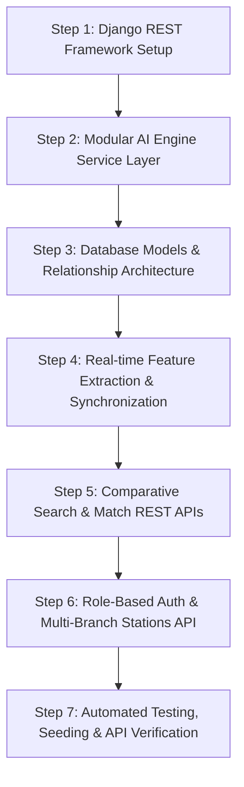

# Missing Person AI System: Comparative Backend Development Roadmap

This document provides a step-by-step breakdown of how the **Missing Person AI Backend** is structured, built, and integrated with the **ArcFace**, **CNN**, and **MediaPipe** machine learning models.

---

## 1. System Vision & Use Cases

### The Real-World Scenario
1. **Multi-Source Network**: Missing person complaints are filed at **Police Stations**, reported by **NGOs**, or submitted directly by **Citizens/Families**.
2. **Central Search Across Branches**: When a police station or NGO in one city uploads a photograph of a lost, found, or unidentified person, the AI scans across all registered cases in all stations and databases.
3. **Comparative AI Intelligence**: Instead of relying on a single algorithm, the system evaluates the input query with **3 distinct AI models**:
   - **ArcFace (InsightFace)**: Deep angular-margin metric learning (State-of-the-art accuracy).
   - **Deep CNN**: Deep Convolutional Neural Network face embedding model + KNN classifier.
   - **MediaPipe Landmark Model**: 3D geometric facial mesh landmarks (478 keypoints) + KNN classifier.
4. **Comparative Analysis Output**: Produces side-by-side match percentages (e.g., ArcFace: **98%**, CNN: **70%**, MediaPipe: **39%**), candidate details, branch contact, and consensus verdict.

---

## 2. Step-by-Step Backend Development Process



---

### Step 1: Project Scaffolding & Configuration
- **Environment**: Use the existing Python environment with Django, DRF, SimpleJWT, OpenCV, InsightFace, TensorFlow, and MediaPipe.
- **Django Project Structure**:
  - `core/`: Global settings, CORS headers for future frontend (React/Vite), JWT configuration, media/static URL routes.
  - `accounts/`: User authentication, JWT tokens, roles (`Police Officer`, `NGO Worker`, `Admin`, `Citizen`).
  - `stations/`: Police stations and NGO branch profiles.
  - `cases/`: Missing, Found, and Unidentified person records.
  - `matching/`: AI comparative search endpoint, query logging, and match audit logs.
  - `ai_engine/`: Standalone Python ML inference layer.

---

### Step 2: Build the AI Engine Service Layer (`ai_engine/`)
Create decoupled, high-performance wrappers around the 3 ML models:
1. **Face Detector & Normalizer (`face_detector.py`)**:
   - Detects face bounding boxes and crops/aligns faces from full-size photos.
2. **ArcFace Engine (`arcface_engine.py`)**:
   - Loads ONNX buffalo_l model.
   - Extracts 512-D L2-normalized embeddings.
   - Computes cosine similarity against all indexed cases.
3. **CNN Engine (`cnn_engine.py`)**:
   - Resizes face crops to (160, 160).
   - Computes 128-D embeddings using the trained Keras CNN.
   - Evaluates KNN classification and cosine similarity scores.
4. **MediaPipe Engine (`mediapipe_engine.py`)**:
   - Extracts 478 3D facial landmark coordinates.
   - Normalizes scale/translation invariance.
   - Evaluates KNN distance and similarity percentage.
5. **Comparative Aggregator (`comparative_matcher.py`)**:
   - Executes all 3 models on the query photo.
   - Normalizes raw scores/distances to uniform 0–100% confidence percentages.
   - Generates the consensus verdict: `MATCH FOUND` (High confidence), `POSSIBLE MATCH` (Moderate confidence), or `NO MATCH`.

---

### Step 3: Database Schema & Models (`models.py`)

#### 1. Station / Branch Model (`stations.models.Station`)
| Field | Type | Description |
|---|---|---|
| `id` | UUID | Primary key |
| `name` | String | Station or NGO name (e.g. "Central Police Station - Sector 4") |
| `branch_type` | Choice | `POLICE_STATION`, `NGO`, `GOVERNMENT_SHELTER` |
| `branch_code` | String | Unique identifier code |
| `city` | String | City location |
| `state` | String | State/Province |
| `contact_phone` | String | Official contact number |
| `contact_email` | Email | Official email address |

#### 2. Case Model (`cases.models.MissingPerson`)
| Field | Type | Description |
|---|---|---|
| `case_id` | String | FIR number / Case reference ID (e.g. "FIR-2026-9042") |
| `full_name` | String | Name of the missing / found person |
| `case_type` | Choice | `MISSING_PERSON`, `FOUND_PERSON`, `UNIDENTIFIED_BODY` |
| `status` | Choice | `ACTIVE`, `FOUND`, `RESOLVED`, `CLOSED` |
| `gender` | Choice | `MALE`, `FEMALE`, `OTHER`, `UNKNOWN` |
| `age` | Integer | Estimated / actual age |
| `date_missing_or_found` | Date | Date when person was lost or found |
| `last_seen_location` | String | Last known location / address |
| `physical_description` | Text | Height, marks, scars, clothing |
| `reporting_station` | ForeignKey | Originating station or NGO |
| `created_by` | ForeignKey | User who created the record |

#### 3. Person Photo Model (`cases.models.PersonPhoto`)
| Field | Type | Description |
|---|---|---|
| `case` | ForeignKey | Linked MissingPerson record |
| `image` | ImageField | Original uploaded photo |
| `face_crop` | ImageField | Extracted face crop |
| `arcface_vector` | JSON/Binary | Cached 512D ArcFace embedding |
| `cnn_vector` | JSON/Binary | Cached 128D CNN embedding |
| `mediapipe_vector` | JSON/Binary | Cached 478 3D MediaPipe landmark array |
| `is_primary` | Boolean | Primary display photo flag |

#### 4. Search Query Audit Log (`matching.models.SearchQueryLog`)
| Field | Type | Description |
|---|---|---|
| `query_image` | ImageField | The uploaded query photograph |
| `searched_by` | ForeignKey | Police / NGO user who initiated search |
| `searched_at` | DateTime | Timestamp of search |
| `top_matched_case` | ForeignKey | Best candidate match (if found) |
| `arcface_score` | Float | ArcFace confidence (0–100%) |
| `cnn_score` | Float | CNN confidence (0–100%) |
| `mediapipe_score` | Float | MediaPipe confidence (0–100%) |
| `verdict` | String | `MATCH_FOUND`, `POSSIBLE_MATCH`, `NO_MATCH` |

---

### Step 4: Real-time Feature Extraction & Synchronization
- When a new case is registered or a new photo is uploaded:
  1. The backend automatically processes the image through the face detector.
  2. Embeddings are extracted for all 3 models (ArcFace, CNN, MediaPipe).
  3. Vectors are cached in memory / database so that all subsequent searches across all branches are sub-second fast.

---

### Step 5: REST API Endpoint Blueprint

#### Authentication (`/api/auth/`)
- `POST /api/auth/register/` - Register officer / NGO account
- `POST /api/auth/login/` - Authenticate & obtain JWT tokens
- `GET /api/auth/profile/` - Current user details & station info

#### Stations & Branches (`/api/stations/`)
- `GET /api/stations/` - List all participating stations & NGOs
- `POST /api/stations/` - Register a new branch / station

#### Cases & Registry (`/api/cases/`)
- `GET /api/cases/` - Filter missing/found cases by status, date, branch, gender
- `POST /api/cases/` - Create a new missing person case (supports multipart photo upload)
- `GET /api/cases/<id>/` - Retrieve complete case history, photos, and match logs
- `PATCH /api/cases/<id>/` - Update case status (e.g. mark as Resolved / Found)
- `POST /api/cases/<id>/photos/` - Attach additional photographs

#### Comparative Search & Match Engine (`/api/match/`)
- `POST /api/match/search/`
  - **Input**: Query image (multipart/form-data) + optional threshold / station filters.
  - **Output Response**:
    ```json
    {
      "status": "success",
      "verdict": "MATCH FOUND",
      "consensus_confidence": 92.4,
      "comparative_breakdown": {
        "arcface": {
          "model_name": "ArcFace Buffalo_L",
          "score_percentage": 98.2,
          "predicted_person": "biswa",
          "match_status": "HIGH_CONFIDENCE"
        },
        "cnn": {
          "model_name": "Deep Face CNN",
          "score_percentage": 70.5,
          "predicted_person": "biswa",
          "match_status": "MODERATE_CONFIDENCE"
        },
        "mediapipe": {
          "model_name": "MediaPipe Landmark Mesh (478-pt)",
          "score_percentage": 39.1,
          "predicted_person": "biswa",
          "match_status": "LOW_CONFIDENCE"
        }
      },
      "candidate_matches": [
        {
          "rank": 1,
          "case_id": "FIR-2026-0042",
          "name": "Biswa",
          "age": 28,
          "gender": "MALE",
          "status": "ACTIVE",
          "reporting_station": "Central Police Station - Sector 4",
          "contact_phone": "+91-9876543210",
          "primary_photo_url": "/media/photos/biswa.jpg",
          "scores": {
            "arcface": 98.2,
            "cnn": 70.5,
            "mediapipe": 39.1,
            "average": 69.26
          }
        }
      ]
    }
    ```

#### Analytics & Overview (`/api/analytics/`)
- `GET /api/analytics/summary/` - Total missing cases, resolved cases, monthly trends, branch statistics, and model comparison benchmarks.

---

### Step 6: Testing, Seeding & API Verification
1. Create a management command / seed script to import registered sample identities from `mpp/data/registered/` into the Django database.
2. Run automated test cases for:
   - Case creation with automatic vector generation.
   - Search query endpoint with sample test images.
   - Verification of the 3-model comparative response schema.

---

## 3. Future Frontend Integration Plan (Next Phase)
Once backend verification is complete, we will build the modern web interface:
- **Police / NGO Dashboard**: Live case tracker, case filing modal with drag-and-drop photo upload.
- **AI Comparative Match Inspector**: Interactive side-by-side photo comparison viewer with dynamic score meters for ArcFace, CNN, and MediaPipe.
- **Station Directory & Case Map**: Visual network of police stations & NGO shelters.
