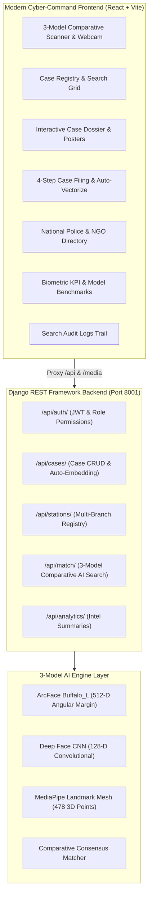

# Missing Person AI: National 3-Model Comparative Biometric Intelligence & Case Tracking System

A full-stack, enterprise-grade biometric tracking and face recognition application designed for **Police Departments**, **NGO Shelter Networks**, and **Citizen Lost-and-Found Portals**.

The system performs automated parallel multi-algorithm evaluations across **3 distinct AI face recognition models** (**ArcFace**, **Deep CNN**, and **MediaPipe 3D Mesh**) to establish consensus identity matches, cross-agency collaboration, and audit logs.

---

## 🏗️ Architecture & Core Components



---

## ⚡ Quick Start Guide

### Option A: 1-Click Launcher (Windows)
Double-click [`start_fullstack.bat`](file:///c:/Users/shrut_hi39oyy/Downloads/missing_person_AI-main/start_fullstack.bat) to start both the Django backend and Vite frontend automatically!

### Option B: Manual Startup

#### 1. Backend Server (Django REST Framework)
```bash
cd backend
..\.venv\Scripts\python.exe manage.py migrate
..\.venv\Scripts\python.exe manage.py seed_demo_data
..\.venv\Scripts\python.exe manage.py runserver 127.0.0.1:8001
```

#### 2. Frontend Application (React + Vite)
```bash
cd frontend
npm install
npm run dev
```

- **Frontend URL**: `http://localhost:5173/`
- **Backend API Root**: `http://127.0.0.1:8001/api/`
- **Django Admin Panel**: `http://127.0.0.1:8001/admin/`

---

## 👤 Default User Accounts & Demo Personas

| Role | Username | Password | Purpose |
|---|---|---|---|
| **System Administrator** | `admin` | `admin123password` | Full Django Admin and database management |
| **Police Officer** | `officer_rajesh` | `policepassword123` | Case registration, investigations, and search queries |
| **NGO Relief Worker** | `ngo_ananya` | `ngopassword123` | Shelter home check-ins and cross-station inquiries |

---

## 🧠 3-Model AI Comparative Engine

1. **ArcFace Buffalo_L (Deep Angular Margin)**:
   - 512-dimensional normalized face embeddings with cosine similarity.
   - Best-in-class invariance to lighting, angle, and slight age variation.
2. **Deep Face CNN (Convolutional Feature Extractor)**:
   - 128-dimensional dense structural embedding for robust facial morphology.
3. **MediaPipe Facial Mesh (478-Point 3D Geometry)**:
   - 3D spatial keypoint cloud mapping landmarks across eyes, nose bridge, jawline, and mouth geometry.
4. **Consensus Aggregator**:
   - Computes normalized confidence percentages across all models, generating consensus verdicts (`MATCH FOUND`, `POSSIBLE MATCH`, `NO MATCH`).

---

## 📡 REST API Blueprint

- `POST /api/match/search/`: Upload probe image; runs ArcFace, CNN, and MediaPipe; returns comparative breakdown and ranked candidate matches.
- `GET /api/cases/`: Filter and search cases by type, status, gender, station, city, and state.
- `POST /api/cases/`: Register a new missing/found person record with automatic photo vectorization.
- `GET /api/cases/<id>/`: Retrieve complete case record, face crops, and photo gallery.
- `PATCH /api/cases/<id>/`: Update investigation status (`ACTIVE`, `FOUND`, `RESOLVED`, `CLOSED`).
- `POST /api/cases/reindex/`: Re-synchronize in-memory embedding feature store across all cases.
- `GET /api/stations/`: List all participating police stations, NGO shelters, and welfare homes.
- `GET /api/analytics/summary/`: High-level KPIs, resolution rates, and model benchmark comparisons.
- `GET /api/match/history/`: Cryptographically logged search audit trail.

---

## 🧪 Automated Integration Tests
To run the automated backend verification suite:
```bash
cd backend
..\.venv\Scripts\python.exe test_api_endpoints.py
```
